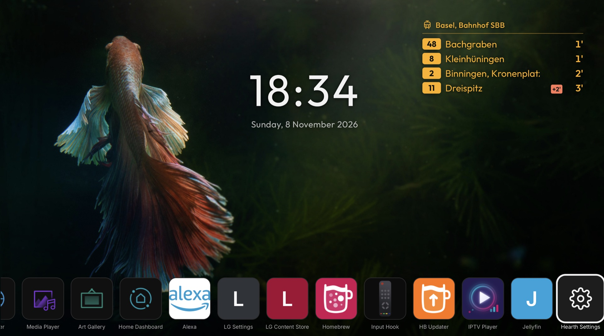
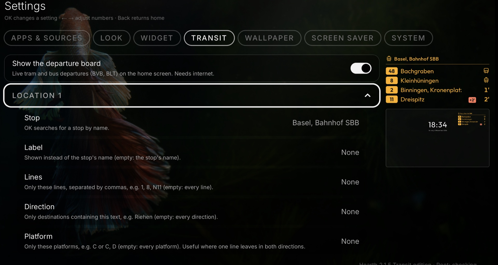
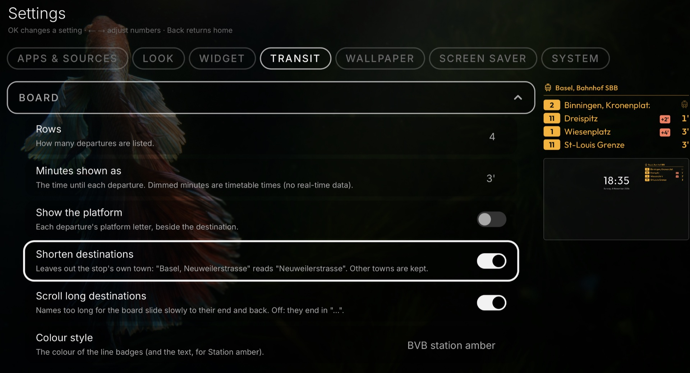

# Transit: the Basel departure board (Transit edition)

> **Transit edition only.** This board is part of an unofficial variant of Hearth, *Hearth 2.1.5 Transit edition*. It is not part of the original Hearth releases.

The departure board shows the next trams and buses (BVB and BLT) from one or two stops in Basel, with live delays. Find it in **Settings, Transit**. A small live picture of the board sits beside the list, and under it a miniature of the whole screen, so you see where the board sits next to the clock.

- **Show the departure board:** off at first. The first time it is on, Hearth looks up the two starting stops, *Basel, Barfüsserplatz* and *Basel, Bahnhof SBB*.
- **Location 1:** the **Stop** (OK opens a search; type at least two letters, the stops appear below), a **Label** shown instead of the stop's name, and three filters: **Lines** (for example `1, 8, N11`), **Direction** (part of a destination, for example `Riehen`; accents do not matter) and **Platform** (for example `C`, useful where one line leaves in both directions).

- **Location 2:** a second stop with the same rows, shown in turn with the first. **Switch every** sets how long each one shows (5 to 60 seconds); *Off* shows Location 1 only.
- **Board:** how many **Rows** (2 to 6), minutes shown as `3'` or `3 min`, **Show the platform**, **Shorten destinations** (leaves out the stop's own town: *Basel, Neuweilerstrasse* reads *Neuweilerstrasse*), **Scroll long destinations** (names that do not fit slide to their end and back; off, they end in "…"), the **Colour style** (BVB station amber, BVB line colours, the clock's colour, or one of the widget colours), text size, font and opacity. The shadow follows the clock's.
- **Position:** alignment, position across and position from the top, the same way as the clock.

## Reading the board

- The minutes count down on the TV itself, from the timetable time plus the delay.
- A coral badge such as `+2'` is the delay.
- Minutes drawn dimmer are timetable times only: the service sent no live data for that departure.
- A pulsing tram (or bus) means it leaves now. On webOS 3 the icon does not pulse.
- *offline* in the board's title means the last update failed; the saved departures stay on screen.

## Switching the stop with the remote

With two locations taking turns, press **Up** on the top row of apps: the board gets a frame. **OK** shows the other stop at once and starts the wait again. **Down** or **Back** return to the apps.

## About the data and privacy

The departures come from [transport.opendata.ch](https://transport.opendata.ch), a free service with no account. Hearth sends only the stop's number (and the words you type in the stop search). It asks once a minute while Hearth is in front and the board is on, and waits longer (up to 5 minutes) after a failure. The last answer is kept, so the board shows at once at start; an answer older than 3 hours is not shown. Nothing is asked while the board is off.

The line colours are approximate and not official; they can be changed in `src/lib/transitcolors.ts`.

The board's texts are in English only; in other languages they show in English.
